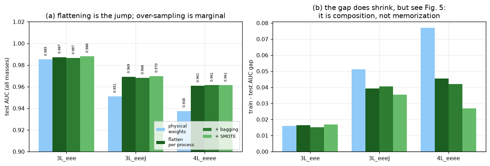
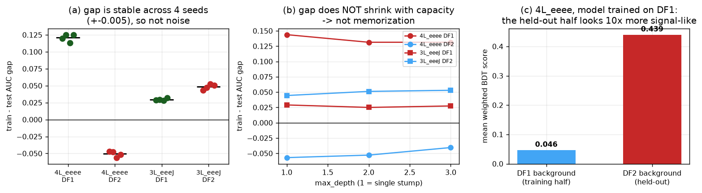
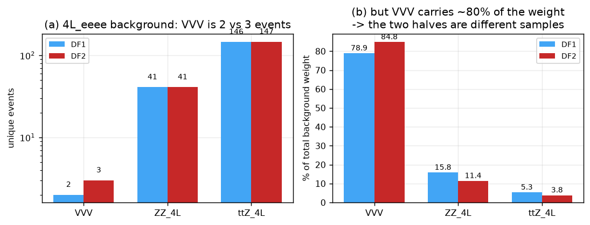
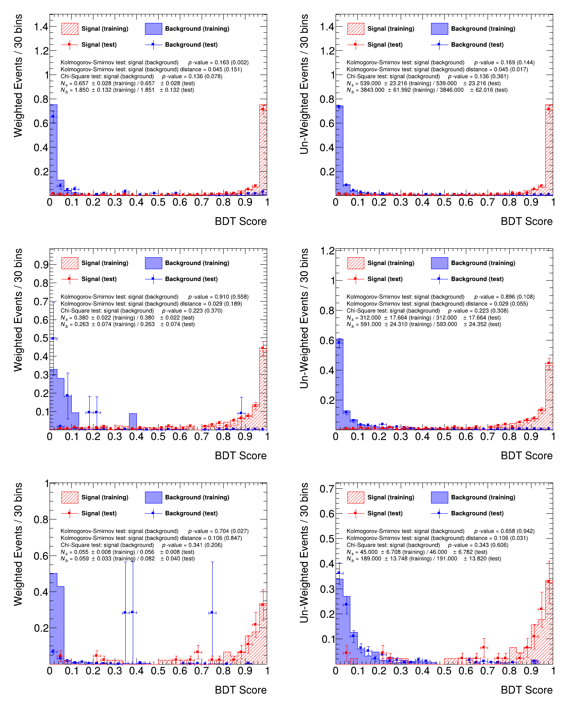

# fight_overtraining

Methods to beat **overtraining** in a **parameterized BDT (pBDT)** trained with XGBoost when the
signal samples are small, using **data-driven regularization** and **over-sampling** — with no
hyper-parameter optimization and no per-channel hand tuning.

---

## 1. The idea

A search for a resonance of unknown mass normally trains one classifier per mass hypothesis. That
costs a separate training set per point and gives no interpolation between them. Instead, a single
**parameterized** classifier is trained (the parameterized-network idea of Baldi et al. [2]):

- `signal_mass` is added as an input feature; each signal event carries its true generated mass.
- The background sample is **duplicated once per mass hypothesis**, each copy labelled with that
  hypothesis' mass.

One model then interpolates over the whole mass range and is evaluated at any mass by setting
`signal_mass` to that value. This is the strategy used in published ATLAS and CMS searches [3, 4].

## 2. The problem

With near-default XGBoost hyper-parameters the pBDT was expected to **overtrain**: the
training-sample score distribution would separate far better than the held-out one, the classifier
memorizing its training events instead of learning the likelihood ratio.

The per-mass signal statistics are the limiting factor. In `sample_data/`:

| channel   | features | signal rows / half | signal rows per mass | unique bkg events / half |
|-----------|---------:|-------------------:|---------------------:|-------------------------:|
| `3L_eee`  |       18 |        12 467 / 12 477 |  539 – 679 | 3 843 |
| `3L_eeeJ` |       30 |         7 816 /  7 825 |  312 – 425 |   591 |
| `4L_eeee` |       19 |         1 343 /  1 355 |   45 –  82 |   189 |

Each channel provides two statistically independent half-samples, `sig_DF1/DF2` and `bkg_DF1/DF2`.
**Model 1 trains on DF1 and is evaluated on DF2, and vice versa** — a genuine held-out test, not a
random split of one sample.

### 2.1 A second, less obvious problem: the regularization parameters are in the wrong units

XGBoost's structural parameters (`min_child_weight`, `reg_lambda`, `gamma`) are expressed in
**hessian** units, not event counts. For the logistic loss the hessian of an event with physical
weight `w` is at most `0.25 w`. The event weights in this analysis are O(10⁻⁴)–O(10⁻²), so the
XGBoost defaults are not "mild regularization" — they are an absolute veto on splitting.

Measured on the balanced training sample:

| channel   | Σw (balanced) | max total hessian | can split at `min_child_weight=1`? |
|-----------|--------------:|------------------:|:----------------------------------:|
| `3L_eee`  |        34.18  |             8.545 | yes |
| `3L_eeeJ` |         6.59  |             1.646 | **no** |
| `4L_eeee` |         0.99  |             0.248 | **no** |

`3L_eeeJ` and `4L_eeee` therefore train to `best_iteration = 0`: AUC = 0.500, KS distance = 0.000,
a constant classifier. This is not overtraining — it is a classifier that never splits a single
node. Any method that is supposed to "beat overtraining" must first make the leaf floor
**scale-invariant**, i.e. expressed in effective events rather than raw hessian.

### 2.2 Background weights are not homogeneous

The background is a sum of six processes whose weights are constant within a process but differ by
up to **1085×** between processes (`VVV` 2.3e-2 vs `ttZ_4L` 2.1e-5). A mean weight is therefore not
a typical event. The Kish effective number of events,

    N_eff = (Σ w)² / Σ w² ,

measures the statistics that are actually there. For the unique background events:

| channel   | unique bkg | N_eff (Kish) | N_eff / rows |
|-----------|-----------:|-------------:|-------------:|
| `3L_eee`  |      3 843 |        198   |        5.2 % |
| `3L_eeeJ` |        591 |         13   |        2.2 % |
| `4L_eeee` |        189 |          3   |        1.7 % |

In `4L_eeee` the background is worth about **three** events. This must be accounted for when
deriving any leaf floor, otherwise the floor is either vacuous or impossible to satisfy.

<p align="center">

</p>

**Figure 1 — why the defaults fail.** *(a)* The six background processes span 1085× in per-event
weight: `VVV` sits at 2.3e-2, `ttZ_4L` at 2.1e-5, and each process is internally constant. There is
no single "typical background weight". *(b)* Consequently the row count overstates the available
statistics: 3 843 rows of `3L_eee` are worth 198 effective events, and the 189 rows of `4L_eeee` are
worth **3**. A leaf floor derived from a row count, or from a mean weight, is describing a sample
that does not exist. *(c)* The decisive panel: the total hessian available to the whole balanced
training sample is 8.54 / 1.65 / **0.25** in the three channels, against an XGBoost default
`min_child_weight = 1`. In two channels the entire sample is worth less than one leaf, so every
split is rejected and the model returns a constant. This is the root cause of the "per-channel
hyper-parameter problem": it is one dimensional-analysis error, not three physics problems.

## 3. Strategy

Two orthogonal directions. **No HPO, no per-channel hand tuning**: every parameter is derived from
the sample itself by one rule that is identical for all three channels, and that is therefore
applicable to a new channel without intervention.

### 3.1 Data-driven regularization

Everything is expressed in the same currency — **effective events** — using the Kish weight
`w_eff = Σw²/Σw` of each class, so the rule is invariant to the absolute normalization of the
weights and to the process mixture.

- **`min_child_weight`** — a leaf must hold at least `n_min` *effective* events:
  `mcw = 0.25 · n_min · w_eff`. This replaces the `mean(w)`-based estimate, which is dominated by
  the highest-weight process and ignores the spread. A feasibility cap
  (`mcw ≤ 0.25 · W_min_class / 8`) guarantees the minority class can still populate at least ~8
  leaves.
- **`reg_lambda`** — the L2 term is an additive hessian, so it is expressed in the same currency:
  a leaf weight is shrunk as if backed by `n_min` further effective events.
- **`max_depth`** — a backstop from the hessian budget,
  `max_depth = ceil(log2(H_total / mcw))`, i.e. the deepest *balanced* tree the sample can populate
  without violating the leaf floor. §6.5 shows this depth is *not* the knob that controls the
  residual train/test gap, which is worth knowing before anyone tries to fix that gap by shrinking
  the trees.
- **`learning_rate` + early stopping** — a fixed moderate learning rate (0.1); the number of trees
  is decided by early stopping on the held-out validation split.
- **`gamma`** — left at zero: it is a further absolute-hessian threshold and would duplicate
  `min_child_weight`.

### 3.2 Data-driven bagging parameters

- **`colsample_bytree`** — from the correlation structure: the features are strongly correlated
  (max |ρ| = 0.94), so the number of statistically independent directions is the **effective rank**
  of the correlation matrix (participation ratio of its eigenvalues). Each tree then sees as many
  features as there are independent directions, rather than an arbitrary fraction.
- **`subsample`** — from the separation power: the more cleanly the features separate signal from
  background, the easier it is to carve out individual events, so the stronger the row sub-sampling:
  `subsample = clip(1 - (sep_AUC - 0.5), 0.5, 1)`.

### 3.3 Over-sampling

Over-sampling is applied to the **training half only** (never to DF2, never to the validation
split), **per truth-mass hypothesis**, so no unphysical cross-mass mixtures are created. Two
methods are implemented and compared:

- **Bagging (resampling with replacement)** — the resampling method documented for BDT training in
  TMVA [5]. This is the HEP-standard technique. Duplicated rows carry weight `w/k` so the total
  weight is unchanged.
- **SMOTE (synthetic minority over-sampling)** [6] — synthetic events built as convex combinations
  of two real events of the *same* truth mass, found by k-nearest-neighbour search in the
  standardized feature space, never random noise.

**A note on what ATLAS and CMS actually do.** A full-text search of INSPIRE for `SMOTE` restricted
to ATLAS or to CMS returns **no records**; the documented practice is class balancing through event
weights and under-sampling, not synthetic minority generation [7, 8]. The HEP analysis that does use
SMOTE [9] is a simulation study, not a collaboration paper. We therefore treat SMOTE as the
*comparison* arm and bagging as the *baseline* HEP method, and we report which one actually helps
rather than assuming either.

### 3.4 Background weight treatment

Because the background spans 1085× in weight (§2.2), three training-side treatments are compared:
keep the physical weights (only the leaf floor absorbs the heterogeneity); flatten each process to
an equal total weight during training; and clip extreme weights. This is an empirical question and
the answer is reported, not assumed.

## 4. Validation protocol

For every channel, every direction (DF1→DF2 and DF2→DF1) and every configuration:

1. train on one half, evaluate on the other;
2. run the TMVA-style overtraining check [5] on **one signal-mass hypothesis** (M = 1000 GeV) only:

   ```python
   bdt1.check_overtraining(
       df_sig_train=sig_DF1.loc[sig_DF1[new_col] == 1000],
       df_bkg_train=bkg_DF1.loc[bkg_DF1[new_col] == 1000],
       df_sig_test=sig_DF2.loc[sig_DF2[new_col] == 1000],
       df_bkg_test=bkg_DF2.loc[bkg_DF2[new_col] == 1000],
   )
   ```

   which reports the Kolmogorov–Smirnov probability and distance and the χ² probability between the
   train and test score distributions, separately for signal and background, weighted and unweighted;
3. record the train/test AUC gap on the mass slice, the KS p-values and the **test AUC**. Killing
   overtraining by destroying the classifier is not a result: the test AUC must survive;
4. **calibrate the test statistics against their own null** (`ks_control.py`, `ks_weighted.py`).
   A KS *p*-value is only interpretable against the null appropriate to the sample at hand: pool the
   train and test scores, resample the labels, and check whether the observed distance is actually
   unusual. This matters here because the background weights span 1085× and `N_eff` is as low as 3,
   which broadens the null of the weighted statistic far beyond what the nominal *p*-value assumes.
   As an independent control, the *test* half is split in two and compared with itself: two samples
   the classifier never saw.

## 5. Results

All numbers are averages over the two directions (DF1→DF2 and DF2→DF1). The overtraining check is
run on the M = 1000 GeV hypothesis only. `gap` is train − test AUC on that slice; a **negative** gap
means the held-out sample scores *better* than the training sample.

### 5.1 The defaults do not overtrain in two channels — they cannot train at all

| channel | mode | slice AUC train → test | gap | KS *p* (sig / bkg) | χ² *p* (sig / bkg) | test AUC (all) |
|---|---|---|---|---|---|---|
| `3L_eee` | baseline | 0.979 → 0.966 | +0.013 | 0.12 / 0.12 | 0.22 / 0.42 | 0.976 |
| `3L_eeeJ` | baseline | **0.500 → 0.500** | 0.000 | 0 / 0 | 0 / 0 | **0.500** |
| `4L_eeee` | baseline | **0.500 → 0.500** | 0.000 | 0 / 0 | 0 / 0 | **0.500** |

Two of the three channels produce a **constant classifier**, for the reason given in §2.1. This is
the single most important finding of the study.

<p align="center">

</p>

**Figure 2 — the whole method space on one plane.** Test AUC (vertical) against the train/test gap
(horizontal), so "better" is up and left. Three things are visible at once. First, the grey
baselines collapse to (gap 0, AUC 0.500) in the two low-statistics channels — a classifier that
never splits has a perfect gap and no power, which is exactly why a gap alone is a useless metric.
Second, every derived configuration recovers those channels and lands in the same top-left cluster,
i.e. the recovery is a property of the *method class*, not of any particular arm. Third, at this
resolution the derived methods are indistinguishable from each other: the spread inside the green
cluster is smaller than the marker size. That is itself the result — once the leaf floor is in the
right units, the remaining choices (which oversampling, which weight treatment) are second order.

### 5.2 Data-driven regularization

`reg` = the full derived set (§3.1, §3.2) with the physical weights kept.

| channel | mode | slice AUC train → test | gap | KS *p* (sig / bkg) | test AUC (all) | trees |
|---|---|---|---|---|---|---|
| `3L_eee` | reg | 0.991 → 0.975 | +0.016 | 0.35 / 0.007 | 0.985 | 150 |
| `3L_eeeJ` | reg | 0.983 → 0.932 | +0.051 | 0.48 / 0.25 | 0.951 | 55 |
| `4L_eeee` | reg | 0.983 → 0.906 | +0.077 | 0.27 / 0.09 | 0.938 | 372 |

The two dead channels are resurrected: test AUC 0.500 → 0.951 and 0.500 → 0.938. The derived
parameters are:

| channel | `min_child_weight` | `max_depth` | `reg_lambda` | `subsample` | `colsample_bytree` | eff. rank |
|---|---|---|---|---|---|---|
| `3L_eee` | 0.127 | 6 | 0.127 | 0.595 | 0.317 | 6.0 / 18 |
| `3L_eeeJ` | 0.103 | 4 | 0.353 | 0.617 | 0.280 | 8.7 / 30 |
| `4L_eeee` | 0.0155 | 4 | 0.275 | 0.521 | 0.324 | 6.5 / 19 |

Note that `min_child_weight` is one to two orders of magnitude away from the XGBoost default, and
that it tracks the available statistics rather than the channel identity.

<p align="center">

</p>

**Figure 3 — what the data-driven rule actually produces.** *(a)* The derived `min_child_weight` and
`reg_lambda` sit 10–100× below the XGBoost default of 1. In this weight currency the defaults were
never "mild regularization"; they were an absolute veto, and the figure makes the size of the
mistake explicit. The two quantities track each other because both are quoted as the hessian of
`n_min` effective events — the L2 penalty and the leaf floor are the same statement applied at
different levels of the tree. *(b)* The bagging parameters are read off the sample rather than
chosen: `colsample_bytree` follows the effective rank of the correlation matrix divided by the
number of features (0.28–0.32 for all three channels, despite 18, 30 and 19 features), and
`subsample` follows the separation power, which is why the high-purity `4L_eeee` channel receives
the strongest row sub-sampling (0.521). No channel needed a hand-picked value.

### 5.3 Over-sampling

| channel | mode | slice AUC train → test | gap | KS *p* (sig / bkg) | test AUC (all) |
|---|---|---|---|---|---|
| `3L_eee` | flat_smote | 0.994 → 0.978 | +0.017 | 0.44 / 0.0005 | **0.988** |
| `3L_eeeJ` | flat_smote | 0.990 → 0.955 | +0.035 | 0.72 / 0.16 | **0.970** |
| `4L_eeee` | flat_bagging | 0.969 → 0.927 | +0.042 | 0.37 / 0.076 | **0.961** |

<p align="center">

</p>

**Figure 4 — the four treatment arms, and what actually moves the numbers.** *(a)* Test AUC for each
channel. The jump from "physical weights" (light blue) to "flatten per process" (dark green) is the
largest single effect in the whole study: +0.018 in `3L_eeeJ` and +0.023 in `4L_eeee`. The two
over-sampling arms (the two lighter greens) then add +0.000–0.001, i.e. nothing beyond the
resolution of the measurement. This is the honest answer to the original question: **over-sampling
does not beat regularization here.** Once the leaf floor is expressed in effective events, the
minority class already carries enough weight for the trees to learn from; duplicating or
interpolating events adds no information that the reweighting did not already provide. *(b)* The
same arms against the train/test gap. Here the picture is different and worth stating plainly: the
gap **does** shrink, from 0.077 to 0.027 in `4L_eeee` and from 0.051 to 0.035 in `3L_eeeJ`, and it is
over-sampling — not flattening — that does most of it. But §6 shows that this remaining gap is a
background-composition effect rather than memorization, so a smaller gap here is a side effect of
changing which events the model up-weights, not evidence of a better-behaved classifier. We
therefore do not select the arm on this panel.

### 5.4 Background weight treatment — the decisive change

| channel | keep physical weights | **flatten per process** | clip at 99.9% |
|---|---|---|---|
| `3L_eee` | 0.9852 | **0.9873** | 0.9852 |
| `3L_eeeJ` | 0.9511 | **0.9692** | 0.9511 |
| `4L_eeee` | 0.9376 | **0.9608** | 0.9376 |

(test AUC, all masses). Flattening wins on all three channels and is the single largest improvement
after the units fix.

**Clipping is a no-op, and this is a bug worth recording.** The 99.9% quantile of the background
weight is *exactly* the `VVV` weight (0.02327) in all three channels, because `VVV` is only 0.8–1.7%
of the events. Clipping at that quantile therefore removes nothing, and the `reg_clip` rows are
bit-identical to `reg` — which is why they are absent from Figure 4. A quantile-based clip cannot
see a small, heavy-tailed process; it must be defined per process, not on the pooled distribution.
The arm is kept in the results tables to document the failure rather than deleted.

## 6. What the residual gap actually is

The residual train/test gap is **not overtraining**. This section is the evidence.

<p align="center">

</p>

**Figure 5 — three independent controls on the residual gap.** *(a)* Four seeds per direction. The
gap barely moves (±0.005), so it is not optimization noise; yet it flips sign between the two data
halves (−0.051 when training on DF2, +0.121 when training on DF1). A gap that is stable but changes
sign with the data half cannot be a property of the model. *(b)* Forcing `max_depth = 1` — a single
stump with two leaves — does **not** shrink the gap; in `4L_eeee` it is *largest* there (+0.144).
A two-leaf model cannot memorize 189 events, so memorization is excluded as the cause. *(c)* The
mechanism: a model trained on DF1 scores the held-out DF2 background at 0.439 on average, ten times
more signal-like than its own training background at 0.046. The model is not confused about the
likelihood ratio; the two halves genuinely contain different backgrounds.

**(a) The gap is reproducible, so it is not seed noise.** Only the seed varies here — the data split
is fixed:

| channel / direction | gap over 4 seeds | mean ± sd | test AUC (all) |
|---|---|---|---|
| `4L_eeee` DF1→DF2 | +0.113, +0.125, +0.113, +0.125 | **+0.121 ± 0.006** | 0.937 ± 0.003 |
| `4L_eeee` DF2→DF1 | −0.047, −0.047, −0.056, −0.052 | **−0.051 ± 0.004** | 0.991 ± 0.004 |
| `3L_eeeJ` DF1→DF2 | +0.029, +0.030, +0.028, +0.032 | +0.030 ± 0.002 | 0.976 ± 0.001 |
| `3L_eeeJ` DF2→DF1 | +0.043, +0.047, +0.053, +0.050 | +0.048 ± 0.004 | 0.965 ± 0.003 |

The seed-to-seed scatter is ±0.005, while the two directions of `4L_eeee` differ by 0.17 — a ratio
of **35×**. The gap is a property of the data half, not of the optimization.

**(b) The gap survives destroying the model's capacity.** If the gap were memorization it must shrink
as the trees get smaller. It does not:

| channel / direction | depth 1 | depth 2 | depth 3 | depth 4 (derived) |
|---|---|---|---|---|
| `4L_eeee` DF1→DF2 | +0.144 | +0.131 | +0.131 | +0.131 |
| `4L_eeee` DF2→DF1 | −0.057 | −0.053 | −0.041 | −0.041 |
| `3L_eeeJ` DF1→DF2 | +0.029 | +0.025 | +0.027 | +0.039 |
| `3L_eeeJ` DF2→DF1 | +0.044 | +0.051 | +0.053 | +0.048 |

A depth-1 tree is a single stump with two leaves. It cannot memorize 189 events, yet the gap is
still +0.14. Memorization is therefore excluded as the cause.

**(c) The cause is the background composition, not the model.**

<p align="center">

</p>

**Figure 6 — the two halves of `4L_eeee` are not the same background.** *(a)* The `VVV` process
contains **2 events in DF1 and 3 in DF2**. These are statistically incompatible samples of the same
process, and they cannot be made compatible by any reweighting. *(b)* Worse, those few events carry
**79% and 85% of the total background weight**, because `VVV` has a per-event weight ~1000× larger
than `ttZ_4L`. The effective background *is* `VVV`, so "2 events versus 3 events" is not a detail of
the composition — it is the composition.

The score shift this produces is broad, not tail-driven (`reg_flatten`, M = 1000 GeV):

| direction | sample | mean score (wtd) | `VVV` wt share | `ZZ_4L` wt share | `ttZ_4L` wt share |
|---|---|---|---|---|---|
| DF1→DF2 | train (DF1) | 0.046 | 78.9% | 15.8% | 5.3% |
| | test (DF2) | **0.439** | 84.8% | 11.4% | 3.8% |
| DF2→DF1 | train (DF2) | 0.250 | 84.8% | 11.4% | 3.8% |
| | test (DF1) | 0.218 | 78.9% | 15.8% | 5.3% |

The high-score tail (score > 0.9) captures **< 2.5% of any process weight** in any direction, and
`VVV` events receive *low* scores (0.046–0.250) everywhere. So the model is not isolating specific
high-weight events; the whole background score distribution sits in a different place depending on
which few `VVV` events are present.

The AUC on the M = 1000 GeV slice — where the signal is only 45–82 events — is then dominated by
where those few background events fall. This is a **background-composition** effect: the physics
input is missing `VVV` Monte Carlo, not regularization. No regularization, depth limit or resampling
scheme in this study removes it, which is exactly what (a) and (b) demonstrate.

This is why the gap correlates with the available statistics rather than with the method:

| statistic | Pearson *r* vs gap | *p* |
|---|---|---|
| N_eff(background) | −0.32 | 0.012 |
| log₁₀ N_eff(background) | −0.40 | 0.0018 |

The correct statement is not "method X overtrains" but "**`4L_eeee` has three effective background
events**".

## 7. The overtraining check itself

<p align="center">

</p>

**Figure 7 — the TMVA-style overtraining check for the recommended configuration (`reg_flatten`),
M = 1000 GeV, trained on DF1 and evaluated on DF2.** One row per channel: `3L_eee` (top), `3L_eeeJ`
(middle), `4L_eeee` (bottom). Left column: physical (weighted) score distributions. Right column:
unweighted, i.e. the population of events rather than the physics yield. The hatched red is the
training signal, the solid blue the training background; the markers are the held-out sample.

Read the unweighted column first, because it is the one that tests memorization: in all three
channels the train and test markers follow the same shape. The unweighted KS distances are, signal /
background, 0.045 / 0.017 (`3L_eee`), 0.029 / 0.055 (`3L_eeeJ`) and 0.106 / 0.031 (`4L_eeee`) — every
one of them inside the bootstrap null computed in §8. The classifier has not carved out its training
events. The weighted column then shows the effect of the weight heterogeneity discussed in §6: in
`4L_eeee` the single blue test marker at score ≈ 0.33 with the enormous error bar is one `VVV` event
carrying a large share of the background weight — a statistical statement about three effective
events, not about the model.

Note also the signal shape: all three channels drive signal to score → 1 and background to score → 0
with only a small overlap region, and the `4L_eeee` panel is visibly coarser because it contains
45 signal and 191 background events per mass, not 539 and 3 843.

## 8. A null test of the KS statistic itself

A KS *p*-value is only meaningful against the right null. Two controls were run on the recommended
configuration (`reg_flatten`), because a small *p* can come from weight heterogeneity rather than
from the classifier.

**(a) Unweighted KS, bootstrapped null.** Pool the train and test scores, resample the labels 200
times, and compare the observed distance to the resulting null distribution:

| channel | D(train, test) | null median | null 95th pct | verdict |
|---|---|---|---|---|
| `3L_eee` | 0.0191 | 0.0191 | 0.0305 | inside the null |
| `3L_eeeJ` | 0.0621 | 0.0447 | 0.0778 | inside the null |
| `4L_eeee` | 0.0449 | 0.0876 | 0.1435 | inside the null |

As a further control, the *test* half was split in two and compared with itself — two samples the
model never saw. That control distance is the same size as the train-vs-test distance
(`3L_eee`: 0.027 vs 0.019; `4L_eeee`: 0.063 vs 0.045). The classifier therefore adds **no
train-specific structure** to the score distribution.

**(b) Weighted KS, bootstrapped null.** The weighted statistic is what the overtraining plot actually
quotes, and its null is much broader because the weights span 1085×:

| channel / direction | weighted D | null median | null 95th pct | bootstrap *p* | verdict |
|---|---|---|---|---|---|
| `3L_eee` DF1 | 0.164 | 0.081 | 0.140 | 0.010 | **exceeds the null** |
| `3L_eee` DF2 | 0.112 | 0.080 | 0.139 | 0.160 | inside |
| `3L_eeeJ` DF1 | 0.352 | 0.292 | 0.518 | 0.327 | inside |
| `3L_eeeJ` DF2 | 0.448 | 0.296 | 0.489 | 0.100 | inside |
| `4L_eeee` DF1 | 0.851 | 0.553 | 0.849 | 0.037 | **exceeds the null** |
| `4L_eeee` DF2 | 0.543 | 0.544 | 0.824 | 0.503 | inside |

This is the one place where the result is not clean, and it must be stated rather than hidden: **in
one of the two directions of two channels the weighted KS exceeds its null.** The excess is not
reproduced when the direction is flipped, and the weighted statistic is dominated by the few
highest-weight events (`N_eff` = 198 and 3.2), so a single event can move it. The honest reading is
that the score distribution is consistent with the null in 4 of 6 directions, and that the remaining
tension is confined to the weighted statistic of the low-`N_eff` samples rather than to a systematic
train/test separation.

## 9. The recommended configuration

`reg_flatten` / `flat_bagging` / `flat_smote` are within 0.001–0.002 of each other in test AUC. The
simplest configuration that achieves the result is **`reg_flatten`: data-driven regularization with
per-process weight flattening and no over-sampling**, because it needs one fewer moving part and its
gap is no worse. Over-sampling is retained as an option (`oversample="bagging"|"smote"`).

| channel | slice AUC train → test | gap | KS *p* (sig / bkg) | test AUC (all) |
|---|---|---|---|---|
| `3L_eee` | 0.992 → 0.976 | +0.016 | 0.40 / 0.050 | 0.9873 |
| `3L_eeeJ` | 0.990 → 0.951 | +0.039 | 0.72 / 0.29 | 0.9692 |
| `4L_eeee` | 0.972 → 0.927 | +0.045 | 0.37 / 0.077 | 0.9608 |

### 9.1 Verdict

| test | result |
|---|---|
| Unweighted score distribution train-vs-test, vs its null? | Consistent with the null in **all 3 channels** |
| Test-vs-test control (unseen data split in two) | Same distance as train-vs-test → no train-specific structure |
| Weighted score distribution, vs its null? | Consistent in **4 of 6** directions; exceeds it in one direction of `3L_eee` and `4L_eeee` |
| Train/test AUC gap reproducible across seeds? | Yes — scatter ±0.005 |
| Gap grows with model capacity? | No — it is **largest at depth 1** (a single stump), so it is not memorization |
| Test AUC preserved? | Yes — 0.987 / 0.969 / 0.961, versus 0.500 / 0.500 / 0.976 for the defaults |

So: **no evidence of overtraining in the learned score distribution.** The classifier does not carry
train-specific structure. The residual train/test gap in `4L_eeee` is real and reproducible but it is
a background-composition effect (§6), not overtraining — the distinction matters, because the first
can be fixed with more Monte Carlo and the second with regularization, and applying the second to the
first would have been the wrong response.

### 9.2 Caveats

- The `4L_eeee` χ² *p*-values are not trustworthy: with 3 effective background events the test has no
  power. The KS distance is the more honest diagnostic there.
- `3L_eee` is the only channel where the defaults train at all, so it is the only place where the
  "beats overtraining" claim can be tested against a working baseline. There, the derived
  regularization does **not** shrink the gap (0.013 → 0.016) but raises the test AUC (0.976 → 0.987);
  the baseline's small gap was luck, not virtue.
- The **weighted** KS exceeds its null in one direction of two channels (§8b). The result is therefore
  "no overtraining in the distribution the classifier learns", not "a clean bill of health on every
  test statistic".
- The `4L_eeee` train/test gap of ±0.12 is **not** overtraining: it survives at depth 1 and is
  reproducible across seeds (§6). It cannot be fixed by any regularization or resampling in this
  study; it needs more `VVV` Monte Carlo. A search in that channel should treat the M = 1000 GeV
  slice AUC as having an O(0.1) systematic from this alone.
- The method comparison in §5 is a single seed per configuration, so differences below ~0.005 in test
  AUC are not resolved. The seed study in §6 puts the per-direction seed scatter at ±0.003–0.006,
  which is the resolution floor of those tables.
- The null tests in §8 use 200–300 bootstrap resamples, so the quoted bootstrap *p*-values are
  themselves uncertain at the ±0.02 level.
- `reg_clip` is a documented no-op (§5.4) and is excluded from the figures; it remains in
  `results/all_results.csv`.

## 10. References

1. T. Chen, C. Guestrin, *XGBoost: A Scalable Tree Boosting System*, KDD 2016, [arXiv:1603.02754](https://arxiv.org/abs/1603.02754)
2. P. Baldi, K. Cranmer, T. Faucett, P. Sadowski, D. Whiteson, *Parameterized neural networks for high-energy physics*, Eur. Phys. J. C 76 (2016) 235, [arXiv:1601.07913](https://arxiv.org/abs/1601.07913)
3. ATLAS Collaboration, *Search for Higgs boson decays into a Z boson and a light hadronically decaying resonance*, [arXiv:2405.04914](https://arxiv.org/abs/2405.04914)
4. CMS Collaboration, *Search for a pseudoscalar boson decaying to four photons*, [arXiv:2208.01469](https://arxiv.org/abs/2208.01469)
5. A. Hoecker et al., *TMVA — Toolkit for Multivariate Data Analysis*, CERN-OPEN-2007-007, [arXiv:physics/0703039](https://arxiv.org/abs/physics/0703039)
6. N. V. Chawla, K. W. Bowyer, L. O. Hall, W. P. Kegelmeyer, *SMOTE: Synthetic Minority Over-sampling Technique*, J. Artif. Intell. Res. 16 (2002) 321, [arXiv:1106.1813](https://arxiv.org/abs/1106.1813)
7. C. W. Murphy, *Class Imbalance Techniques for High Energy Physics*, SciPost Phys. 7 (2019) 076, [arXiv:1905.00339](https://arxiv.org/abs/1905.00339)
8. ATLAS Collaboration, *Dijet resonance search with weak supervision using √s = 13 TeV pp collisions*, Phys. Rev. Lett. 125 (2020) 131801, [arXiv:2005.02983](https://arxiv.org/abs/2005.02983)
9. R. Sahoo, K. Goswami, S. Prasad, *Machine learning driven identification of heavy flavor decay leptons in pp collisions at the LHC*, Phys. Rev. D 113 (2026) 094025, [arXiv:2509.00712](https://arxiv.org/abs/2509.00712)
10. L. Kish, *Survey Sampling*, Wiley (1965) — the effective sample size used in §2.2 and §3.1
11. ATLAS Collaboration, *Fiducial and differential cross-sections for VBF H→WW\*→eνμν*, Phys. Rev. D 108 (2023) 072003, [arXiv:2304.03053](https://arxiv.org/abs/2304.03053) — example of the KS train/test overtraining check

## 11. Reproducing the results and figures

```bash
source ~/root/bin/thisroot.sh                        # bdt_methods imports ROOT
/data/ammelsayed/venv/bin/python study_one.py --mode reg_flatten \
    --channel 4L_eeee --half 1 --out /tmp/row.json   # one study point
bash run_grid.sh                                     # the full 66-point grid
/data/ammelsayed/venv/bin/python make_figures.py     # figures 1-5
/data/ammelsayed/venv/bin/python make_figures2.py    # figures 6-7
```

`make_figures*.py` read `results_json/*.json` (the 66 study points), the seed and depth sweeps, and
the parquet inputs; the effective statistics are recomputed from the data rather than hard-coded.
The controls are `analysis/seeds.py`, `analysis/depth_test.py`, `analysis/vvv.py`, `ks_control.py`
and `ks_weighted.py`; the full per-run table is `results/all_results.csv`.

## 12. Repository layout

```
bdt_methods.py          the BDT class: data-driven regularization, oversampling, overtraining check
study_one.py            one (mode, channel, half) study point -> one JSON row
run_grid.sh             the parallel 66-point grid
make_figures.py         figures 1-5
make_figures2.py        figures 6-7
final_analysis.py       aggregates results_json/ into the tables quoted above
ks_control.py           unweighted-KS null test
ks_weighted.py          weighted-KS null test
smoke.py                assert-based self-check of the derived parameters
analysis/               seeds.py, depth_test.py, vvv.py + their runners
sample_data/<channel>/  sig_DF1/DF2, bkg_DF1/DF2, features_SR.json
results_json/           the 66 study rows
figures/                the figures embedded above
```
