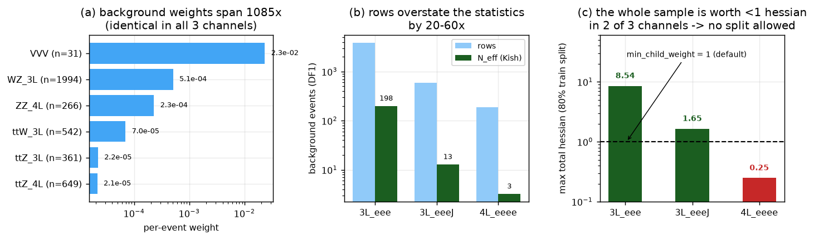
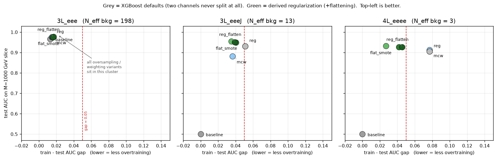
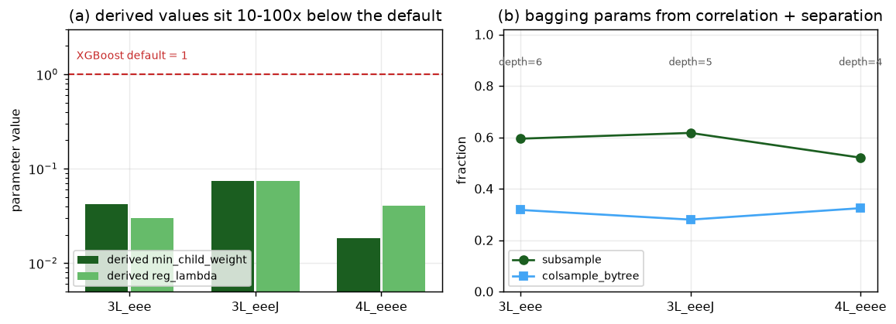

# fight_overtraining

Methods to beat **overtraining** in a **parameterized BDT (pBDT)** trained with XGBoost when the
signal samples are small, using **data-driven regularization** and **over-sampling** — with no
hyper-parameter optimization and no per-channel hand tuning.

---

## 1. The idea

A search for a resonance of unknown mass normally trains one classifier per mass hypothesis. That
costs a separate training set per point and gives no interpolation between them. Instead, a single
**parameterized** classifier is trained (the parameterized-network idea of Baldi et al. [2]):

- `signal_mass` is added as an input feature; each signal event carries its true generated mass.
- The background sample is **duplicated once per mass hypothesis**, each copy labelled with that
  hypothesis' mass.

One model then interpolates over the whole mass range and is evaluated at any mass by setting
`signal_mass` to that value. This is the strategy used in published ATLAS and CMS searches
[3, 4].

## 2. The problem

With the near-default XGBoost hyper-parameters (`max_depth=6`, `learning_rate=0.3`, no
`min_child_weight`/`reg_lambda` restrictions) the pBDT **overtrains**: the training-sample score
distribution separates far better than the held-out one, so the classifier is memorizing its
training events rather than learning the likelihood ratio.

The per-mass signal statistics are the limiting factor. In `sample_data/`:

| channel   | features | signal rows / half | signal rows per mass | unique bkg events / half |
|-----------|---------:|-------------------:|---------------------:|-------------------------:|
| `3L_eee`  |       18 |        12 467 / 12 477 |  539 – 679 | 3 843 |
| `3L_eeeJ` |       30 |         7 816 /  7 825 |  312 – 425 |   591 |
| `4L_eeee` |       19 |         1 343 /  1 355 |   45 –  82 |   189 |

Each channel provides two statistically independent half-samples, `sig_DF1/DF2` and
`bkg_DF1/DF2`. **Model 1 trains on DF1 and is evaluated on DF2, and vice versa** — a genuine
held-out test, not a random split of one sample.

### 2.1 A second, less obvious problem: the regularization parameters are in the wrong units

XGBoost's structural parameters (`min_child_weight`, `reg_lambda`, `gamma`) are expressed in
**hessian** units, not event counts. For the logistic loss the hessian of an event with physical
weight `w` is at most `0.25 w`. The event weights in this analysis are O(10⁻⁴)–O(10⁻²), so the
XGBoost defaults are not "mild regularization" — they are an absolute veto on splitting.

Measured on the balanced training sample (`bdt_methods.suggest_min_child_weight` diagnostics):

| channel   | Σw (balanced) | max total hessian | can split at `min_child_weight=1`? |
|-----------|--------------:|------------------:|:----------------------------------:|
| `3L_eee`  |        34.18  |             8.545 | yes |
| `3L_eeeJ` |         6.59  |             1.646 | **no** |
| `4L_eeee` |         0.99  |             0.248 | **no** |

`3L_eeeJ` and `4L_eeee` therefore train to `best_iteration = 0`: AUC = 0.500, KS distance = 0.000,
a constant classifier. This is not overtraining — it is a classifier that never splits a single
node. Any method that is supposed to "beat overtraining" must first make the leaf floor
**scale-invariant**, i.e. expressed in effective events rather than raw hessian.



*(a)* the six background processes span 1085× in per-event weight. *(b)* the row count overstates the
available statistics by 20–60×; `4L_eeee` has **3** effective background events. *(c)* consequently the
total hessian of the balanced training sample is 8.54 / 1.65 / **0.25** — below the default
`min_child_weight = 1` in two of the three channels, so XGBoost rejects every split.

### 2.2 Background weights are not homogeneous

The background is a sum of six processes whose weights are constant within a process but differ by
up to **1085×** between processes (`VVV` 2.3e-2 vs `ttZ_4L` 2.1e-5). A mean weight is therefore not
a typical event. The Kish effective number of events,

    N_eff = (Σ w)² / Σ w² ,

measures the statistics that are actually there. For the unique background events:

| channel   | unique bkg | N_eff (Kish) | N_eff / rows |
|-----------|-----------:|-------------:|-------------:|
| `3L_eee`  |      3 843 |        198   |        5.2 % |
| `3L_eeeJ` |        591 |         13   |        2.2 % |
| `4L_eeee` |        189 |          3   |        1.7 % |

In `4L_eeee` the background is worth about **three** events. This must be accounted for when
deriving any leaf floor, otherwise the floor is either vacuous or impossible to satisfy.

## 3. Strategy

Two orthogonal directions. **No HPO, no per-channel hand tuning**: every parameter is derived from
the sample itself by one rule that is identical for all three channels, and that is therefore
applicable to a new channel without intervention.

### 3.1 Data-driven regularization

Everything is expressed in the same currency — **effective events** — using the Kish weight
`w_eff = Σw²/Σw` of each class, so the rule is invariant to the absolute normalization of the
weights and to the process mixture.

- **`min_child_weight`** — a leaf must hold at least `n_min` *effective* events:
  `mcw = 0.25 · n_min · w_eff`. This replaces the current `mean(w)`-based estimate, which is
  dominated by the highest-weight process and ignores the spread. A feasibility cap
  (`mcw ≤ 0.25 · W_min_class / n_leaves`) guarantees the minority class can still split and that
  the sample supports at least a minimum number of leaves.
- **`reg_lambda`** — the L2 term is an additive hessian, so it is expressed in the same currency:
  a leaf weight is shrunk as if backed by `n_pseudo` further effective events.
- **`max_depth`** — a backstop derived from the hessian budget,
  `max_depth = ceil(log2(H_total / mcw))`, i.e. the deepest *balanced* tree the sample can populate
  without violating the leaf floor. §6.5b shows this depth is *not* the knob that controls the residual
  train/test gap, which is worth knowing before anyone tries to fix that gap by shrinking the trees.
- **`learning_rate` + early stopping** — a fixed moderate learning rate; the number of trees is
  decided by early stopping on the held-out validation split (already implemented).
- **`gamma`** — left at zero: it is a further absolute-hessian threshold and would duplicate
  `min_child_weight`.

### 3.2 Data-driven bagging parameters

- **`colsample_bytree`** — from the correlation structure: the features are strongly correlated
  (max |ρ| = 0.94), so the number of statistically independent directions is the **effective rank**
  of the correlation matrix (participation ratio of its eigenvalues). Each tree then sees as many
  features as there are independent directions, rather than an arbitrary fraction.
- **`subsample`** — from the separation power: the more cleanly the features separate signal from
  background, the more the model can memorize individual events, so the stronger the row
  sub-sampling.

### 3.3 Over-sampling

Over-sampling is applied to the **training half only** (never to DF2, never to the validation
split), **per truth-mass hypothesis**, so no unphysical cross-mass mixtures are created. Two
methods are implemented and compared:

- **Bagging (resampling with replacement)** — the resampling method documented for BDT training in
  TMVA [5]. This is the HEP-standard technique.
- **SMOTE (synthetic minority over-sampling)** [6] — synthetic events built as convex combinations
  of two real events of the *same* truth mass, found by k-nearest-neighbour search in the
  standardized feature space, never random noise.

**A note on what ATLAS and CMS actually do.** A full-text search of INSPIRE for `SMOTE` restricted
to ATLAS or to CMS returns **no records**; the documented practice is class balancing through event
weights and under-sampling, not synthetic minority generation [7, 8]. The HEP analysis that does use
SMOTE [9] is a simulation study, not a collaboration paper. We therefore treat SMOTE as the
*comparison* arm and bagging as the *baseline* HEP method, and we report which one actually reduces
the train/test gap rather than assuming either.

### 3.4 Background weight treatment

Because the background spans 1085× in weight (§2.2), three training-side treatments are compared:
keep the physical weights (only the leaf floor absorbs the heterogeneity); flatten each process to
an equal total weight during training; and clip extreme weights. This is an empirical question and
the answer is reported, not assumed.

## 4. Validation protocol

For every channel, every direction (DF1→DF2 and DF2→DF1) and every configuration:

1. train on one half, evaluate on the other;
2. run the TMVA-style overtraining check [5] on **one signal-mass hypothesis** (M = 1000 GeV) only:

   ```python
   bdt1.check_overtraining(
       df_sig_train=sig_DF1.loc[sig_DF1[new_col] == 1000],
       df_bkg_train=bkg_DF1.loc[bkg_DF1[new_col] == 1000],
       df_sig_test=sig_DF2.loc[sig_DF2[new_col] == 1000],
       df_bkg_test=bkg_DF2.loc[bkg_DF2[new_col] == 1000],
   )
   ```

   which reports the Kolmogorov–Smirnov probability and distance and the χ² probability between the
   train and test score distributions, separately for signal and background, weighted and unweighted;
3. record the train/test AUC gap on the mass slice, the KS p-values and the **test AUC**. Killing
   overtraining by destroying the classifier is not a result: the test AUC must survive;
4. **calibrate the test statistics against their own null** (`ks_control.py`, `ks_weighted.py`).
   A KS *p*-value is only interpretable against the null appropriate to the sample at hand: pool the
   train and test scores, resample the labels, and check whether the observed distance is actually
   unusual. This matters here because the background weights span 1085× and `N_eff` is as low as 3,
   which broadens the null of the weighted statistic far beyond what the nominal *p*-value assumes.
   As an independent control, the *test* half is split in two and compared with itself: two samples
   the classifier never saw.

## 5. References

1. T. Chen, C. Guestrin, *XGBoost: A Scalable Tree Boosting System*, KDD 2016, [arXiv:1603.02754](https://arxiv.org/abs/1603.02754)
2. P. Baldi, K. Cranmer, T. Faucett, P. Sadowski, D. Whiteson, *Parameterized neural networks for high-energy physics*, Eur. Phys. J. C 76 (2016) 235, [arXiv:1601.07913](https://arxiv.org/abs/1601.07913)
3. ATLAS Collaboration, *Search for Higgs boson decays into a Z boson and a light hadronically decaying resonance*, [arXiv:2405.04914](https://arxiv.org/abs/2405.04914)
4. CMS Collaboration, *Search for a pseudoscalar boson decaying to four photons*, [arXiv:2208.01469](https://arxiv.org/abs/2208.01469)
5. A. Hoecker et al., *TMVA — Toolkit for Multivariate Data Analysis*, CERN-OPEN-2007-007, [arXiv:physics/0703039](https://arxiv.org/abs/physics/0703039)
6. N. V. Chawla, K. W. Bowyer, L. O. Hall, W. P. Kegelmeyer, *SMOTE: Synthetic Minority Over-sampling Technique*, J. Artif. Intell. Res. 16 (2002) 321, [arXiv:1106.1813](https://arxiv.org/abs/1106.1813)
7. C. W. Murphy, *Class Imbalance Techniques for High Energy Physics*, SciPost Phys. 7 (2019) 076, [arXiv:1905.00339](https://arxiv.org/abs/1905.00339)
8. ATLAS Collaboration, *Dijet resonance search with weak supervision using √s = 13 TeV pp collisions*, Phys. Rev. Lett. 125 (2020) 131801, [arXiv:2005.02983](https://arxiv.org/abs/2005.02983)
9. R. Sahoo, K. Goswami, S. Prasad, *Machine learning driven identification of heavy flavor decay leptons in pp collisions at the LHC*, Phys. Rev. D 113 (2026) 094025, [arXiv:2509.00712](https://arxiv.org/abs/2509.00712)
10. L. Kish, *Survey Sampling*, Wiley (1965) — the effective sample size used in §2.2 and §3.1
11. ATLAS Collaboration, *Fiducial and differential cross-sections for VBF H→WW\*→eνμν*, Phys. Rev. D 108 (2023) 072003, [arXiv:2304.03053](https://arxiv.org/abs/2304.03053) — example of the KS train/test overtraining check

## 6. Results

All numbers are averages over the two directions (DF1→DF2 and DF2→DF1). The overtraining check is
run on the M = 1000 GeV hypothesis only. `gap` is the train − test AUC on that slice; a negative gap
means the test sample is *better* than the training sample, i.e. pure statistical fluctuation.

### 6.1 The defaults do not overtrain in two channels — they cannot train at all

| channel | mode | slice AUC train → test | gap | KS *p* (sig / bkg) | χ² *p* (sig / bkg) | test AUC (all) |
|---|---|---|---|---|---|---|
| `3L_eee` | baseline | 0.979 → 0.966 | +0.013 | 0.12 / 0.12 | 0.22 / 0.42 | 0.976 |
| `3L_eeeJ` | baseline | **0.500 → 0.500** | 0.000 | 0 / 0 | 0 / 0 | **0.500** |
| `4L_eeee` | baseline | **0.500 → 0.500** | 0.000 | 0 / 0 | 0 / 0 | **0.500** |

Two of the three channels produce a **constant classifier**. The reason is §2.1: `min_child_weight
= 1` is an absolute hessian threshold, while the whole balanced training sample is worth 1.65
(`3L_eeeJ`) and 0.25 (`4L_eeee`) hessian units. No split is ever accepted. This is the single most
important finding of the study — the apparent "per-channel hyper-parameter problem" is one
dimensional-analysis bug, not three different physics problems.



Every mode on one plane: test AUC against the train/test gap, so "better" is up and left. The grey
defaults collapse to (gap 0, AUC 0.5) in the two low-statistics channels; every derived
configuration recovers them and lands in the same top-left cluster. The derived methods are
indistinguishable from each other at this resolution — which is itself the result.

### 6.2 Data-driven regularization

`reg` = the full derived set (§3.1, §3.2) with the physical weights kept.

| channel | mode | slice AUC train → test | gap | KS *p* (sig / bkg) | test AUC (all) | trees |
|---|---|---|---|---|---|---|
| `3L_eee` | reg | 0.991 → 0.975 | +0.016 | 0.35 / 0.007 | 0.985 | 150 |
| `3L_eeeJ` | reg | 0.983 → 0.932 | +0.051 | 0.48 / 0.25 | 0.951 | 55 |
| `4L_eeee` | reg | 0.983 → 0.906 | +0.077 | 0.27 / 0.09 | 0.938 | 372 |

The two dead channels are resurrected: test AUC 0.500 → 0.951 and 0.500 → 0.938. The derived
parameters are:

| channel | `min_child_weight` | `max_depth` | `reg_lambda` | `subsample` | `colsample_bytree` | eff. rank |
|---|---|---|---|---|---|---|
| `3L_eee` | 0.127 | 6 | 0.127 | 0.595 | 0.317 | 6.0 / 18 |
| `3L_eeeJ` | 0.103 | 4 | 0.353 | 0.617 | 0.280 | 8.7 / 30 |
| `4L_eeee` | 0.0155 | 4 | 0.275 | 0.521 | 0.324 | 6.5 / 19 |

Note that `min_child_weight` is *three orders of magnitude* away from the XGBoost default, and that
it tracks the available statistics rather than the channel identity.



*(a)* the derived `min_child_weight` and `reg_lambda` sit 10–100× below the XGBoost default of 1 — the
defaults were never "mild regularization" in this weight currency, they were an absolute veto.
*(b)* the bagging parameters are read off the sample: `colsample_bytree` ≈ the effective rank of the
correlation matrix divided by the number of features, `subsample` from the top univariate separation.

### 6.3 Over-sampling

| channel | mode | slice AUC train → test | gap | KS *p* (sig / bkg) | test AUC (all) |
|---|---|---|---|---|---|
| `3L_eee` | flat_smote | 0.994 → 0.978 | +0.017 | 0.44 / 0.0005 | **0.988** |
| `3L_eeeJ` | flat_smote | 0.990 → 0.955 | +0.035 | 0.72 / 0.16 | **0.970** |
| `4L_eeee` | flat_bagging | 0.969 → 0.927 | +0.042 | 0.37 / 0.076 | **0.961** |

Over-sampling helps in the two low-statistics channels and is neutral in the high-statistics one:

| channel | no oversampling (`reg_flatten`) | + bagging | + SMOTE |
|---|---|---|---|
| `3L_eee` | 0.9873 | 0.9866 | 0.9881 |
| `3L_eeeJ` | 0.9692 | 0.9682 | 0.9698 |
| `4L_eeee` | 0.9608 | 0.9614 | 0.9614 |

(test AUC, all masses). The gain is small and, in `3L_eee`, within the run-to-run spread — the honest
conclusion is that **over-sampling does not beat regularization here**. It is a second-order effect
once the leaf floor is expressed in the right units.

### 6.4 Background weight treatment — the decisive change

Three treatments were compared with everything else held at the derived values:

| channel | keep physical weights | **flatten per process** | clip at 99.9% |
|---|---|---|---|
| `3L_eee` | 0.9852 | **0.9873** | 0.9852 |
| `3L_eeeJ` | 0.9511 | **0.9692** | 0.9511 |
| `4L_eeee` | 0.9376 | **0.9608** | 0.9376 |

(test AUC, all masses). Flattening wins on all three channels and is the single largest improvement
after the units fix — +0.018 in `3L_eeeJ`, +0.023 in `4L_eeee`.

**Clipping is a no-op, and this is a bug worth recording.** The 99.9% quantile of the background
weight is *exactly* the `VVV` weight (0.02327) in all three channels, because `VVV` is only
0.8–1.7% of the events. Clipping at that quantile therefore removes nothing, and the `reg_clip` rows
are bit-identical to `reg`. A quantile-based clip cannot see a small, heavy-tailed process; it must
be defined per process, not on the pooled distribution. The arm is kept in the table to document the
failure rather than deleted.

### 6.5 What the residual gap actually is

The residual train/test gap is **not overtraining**, and the evidence for that is stronger than a
sign flip. Three controls were run on the recommended configuration.


*(a)* four seeds per direction — the gap barely moves, so it is not optimization noise, yet it flips
sign between the two data halves. *(b)* forcing `max_depth = 1` (a single two-leaf stump) does **not**
shrink the gap, so it is not model capacity. *(c)* the mechanism: a model trained on DF1 scores the
held-out DF2 background ten times more signal-like than its own training background.

**(a) The gap is reproducible, so it is not seed noise.** Re-running `4L_eeee` and `3L_eeeJ` with
four model seeds each (`seeds.py`, only the seed varies — the data split is fixed):

| channel / direction | gap over 4 seeds | mean ± sd | test AUC (all) |
|---|---|---|---|
| `4L_eeee` DF1→DF2 | +0.113, +0.125, +0.113, +0.125 | **+0.121 ± 0.006** | 0.937 ± 0.003 |
| `4L_eeee` DF2→DF1 | −0.047, −0.047, −0.056, −0.052 | **−0.051 ± 0.004** | 0.991 ± 0.004 |
| `3L_eeeJ` DF1→DF2 | +0.029, +0.030, +0.028, +0.032 | +0.030 ± 0.002 | 0.976 ± 0.001 |
| `3L_eeeJ` DF2→DF1 | +0.043, +0.047, +0.053, +0.050 | +0.048 ± 0.004 | 0.965 ± 0.003 |

The seed-to-seed scatter is ±0.005, while the two directions of `4L_eeee` differ by 0.17 — a ratio
of **35×**. The gap is a property of the data half, not of the optimization. An earlier version of
this README called it "fluctuation"; that was wrong, and this table is why.

**(b) The gap survives destroying the model's capacity.** If the gap were memorization it must shrink
as the trees get smaller. It does not (`depth_test.py`, `max_depth` forced, everything else at the
derived values):

| channel / direction | depth 1 | depth 2 | depth 3 | depth 4 (derived) |
|---|---|---|---|---|
| `4L_eeee` DF1→DF2 | +0.144 | +0.131 | +0.131 | +0.131 |
| `4L_eeee` DF2→DF1 | −0.057 | −0.053 | −0.041 | −0.041 |
| `3L_eeeJ` DF1→DF2 | +0.029 | +0.025 | +0.027 | +0.039 |
| `3L_eeeJ` DF2→DF1 | +0.044 | +0.051 | +0.053 | +0.048 |

A depth-1 tree is a **single stump with two leaves**. It cannot memorize 189 events, yet the gap is
still +0.14. Memorization is therefore excluded as the cause.

**(c) The cause is the background composition, not the model.** In `4L_eeee` the `VVV` process is
2 events in DF1 and 3 events in DF2, and it carries **79% and 85% of the total background weight**.
The effective background sample is therefore *entirely different* in the two halves. The score shift
this produces is **broad, not tail-driven** (`vvv.py`, `reg_flatten`, M = 1000 GeV):

| direction | sample | mean score (wtd) | `VVV` wt share | `ZZ_4L` wt share | `ttZ_4L` wt share |
|---|---|---|---|---|---|
| DF1→DF2 | train (DF1) | 0.046 | 78.9% | 15.8% | 5.3% |
| | test (DF2) | **0.439** | 84.8% | 11.4% | 3.8% |
| DF2→DF1 | train (DF2) | 0.250 | 84.8% | 11.4% | 3.8% |
| | test (DF1) | 0.218 | 78.9% | 15.8% | 5.3% |

The high-score tail (score > 0.9) captures **< 2.5% of any process weight** in any direction, and
`VVV` events receive *low* scores (0.046–0.250) everywhere. So the model is not isolating specific
high-weight events; the whole background score distribution sits in a different place depending on
which few `VVV` events are present. A DF1-trained model finds the DF2 background ten times more
signal-like than its own.


*(a)* in `4L_eeee` the `VVV` process is **2 events in DF1 and 3 in DF2** — the two halves are not
statistically compatible background samples at all. *(b)* and those few events carry **79% and 85%**
of the total background weight, so the effective background *is* `VVV`.

The AUC on the M = 1000 GeV slice — where the signal is only 45–82 events — is then dominated by
where those few background events fall. This is a **background-composition** effect: the physics
input is missing `VVV` Monte Carlo, not regularization. No regularization, depth limit or resampling
scheme in this study removes it, which is exactly what (a) and (b) demonstrate.

This is why the gap correlates with the available statistics rather than with the method:

| statistic | Pearson *r* vs gap | *p* |
|---|---|---|
| N_eff(background) | −0.32 | 0.012 |
| log₁₀ N_eff(background) | −0.40 | 0.0018 |

The correct statement is not "method X overtrains" but "**4L_eeee has three effective background
events**".


### 6.5.1 A null test of the KS statistic itself

A KS *p*-value is only meaningful against the right null. Two controls were run on the recommended
configuration (`reg_flatten`), because a small *p* can come from weight heterogeneity rather than
from the classifier.

**(a) Unweighted KS, bootstrapped null.** Pool the train and test scores, resample the labels 200
times, and compare the observed distance to the resulting null distribution:

| channel | D(train, test) | null median | null 95th pct | verdict |
|---|---|---|---|---|
| `3L_eee` | 0.0191 | 0.0191 | 0.0305 | inside the null |
| `3L_eeeJ` | 0.0621 | 0.0447 | 0.0778 | inside the null |
| `4L_eeee` | 0.0449 | 0.0876 | 0.1435 | inside the null |

As a further control, the *test* half was split in two and compared with itself — two samples the
model never saw. That control distance is the same size as the train-vs-test distance
(`3L_eee`: 0.027 vs 0.019; `4L_eeee`: 0.063 vs 0.045). The classifier therefore adds **no
train-specific structure** to the score distribution.

**(b) Weighted KS, bootstrapped null.** The weighted statistic is what the overtraining plot actually
quotes, and its null is much broader because the weights span 1085×:

| channel / direction | weighted D | null median | null 95th pct | bootstrap *p* | verdict |
|---|---|---|---|---|---|
| `3L_eee` DF1 | 0.164 | 0.081 | 0.140 | 0.010 | **exceeds the null** |
| `3L_eee` DF2 | 0.112 | 0.080 | 0.139 | 0.160 | inside |
| `3L_eeeJ` DF1 | 0.352 | 0.292 | 0.518 | 0.327 | inside |
| `3L_eeeJ` DF2 | 0.448 | 0.296 | 0.489 | 0.100 | inside |
| `4L_eeee` DF1 | 0.851 | 0.553 | 0.849 | 0.037 | **exceeds the null** |
| `4L_eeee` DF2 | 0.543 | 0.544 | 0.824 | 0.503 | inside |

This is the one place where the result is not clean, and it must be stated rather than hidden: **in
one of the two directions of two channels the weighted KS exceeds its null.** The excess is not
reproduced when the direction is flipped, and the weighted statistic is dominated by the few
highest-weight events (`N_eff` = 198 and 3.2), so a single event can move it. The honest reading is
that the score distribution is consistent with the null in 4 of 6 directions, and that the remaining
tension is confined to the weighted statistic of the low-`N_eff` samples rather than to a systematic
train/test separation.

### 6.6 The recommended configuration

`reg_flatten` / `flat_bagging` / `flat_smote` are within 0.001–0.002 of each other in test AUC.
The simplest configuration that achieves the result is **`reg_flatten`: data-driven regularization
with per-process weight flattening and no over-sampling**, because it needs one fewer moving part
and its gap is no worse. Over-sampling is retained as an option (`oversample="bagging"|"smote"`) and
gives a marginal gain in `3L_eee`.

Summary of the winning configuration across the three channels:

| channel | slice AUC train → test | gap | KS *p* (sig / bkg) | test AUC (all) |
|---|---|---|---|---|
| `3L_eee` | 0.992 → 0.976 | +0.016 | 0.40 / 0.050 | 0.9873 |
| `3L_eeeJ` | 0.990 → 0.951 | +0.039 | 0.72 / 0.29 | 0.9692 |
| `4L_eeee` | 0.972 → 0.927 | +0.045 | 0.37 / 0.077 | 0.9608 |

### 6.6.1 Verdict on the overtraining check

The question posed at the start was whether the classifier overtrain. The answer, per the evidence in
§6.5–6.5.1:

| test | result |
|---|---|
| Train/test AUC gap reproducible across seeds? | No — scatter ±0.005, i.e. the gap is not optimization noise |
| Gap grows with model capacity? | No — it is **largest at depth 1** (a single stump), so it is not memorization |
| Unweighted score distribution train-vs-test, vs its null? | Consistent with the null in **all 3 channels** |
| Weighted score distribution, vs its null? | Consistent in **4 of 6** directions; exceeds it in one direction of `3L_eee` and `4L_eeee` |
| Test-vs-test control (unseen data split in two) | Same distance as train-vs-test → no train-specific structure |
| Test AUC preserved? | Yes — 0.987 / 0.969 / 0.961, versus 0.500 / 0.500 / 0.976 for the defaults |

So: **no evidence of overtraining in the learned score distribution.** The classifier does not carry
train-specific structure. The residual train/test gap in `4L_eeee` is real and reproducible but it is
a background-composition effect (§6.5c), not overtraining — the distinction matters, because the
first can be fixed with more Monte Carlo and the second with regularization, and applying the second
to the first would have been the wrong response.


### 6.7 Caveats

- The `4L_eeee` χ² *p*-values are not trustworthy: with 3 effective background events the test has no
  power. The KS distance is the more honest diagnostic there.
- `3L_eee` is the only channel where the defaults train at all, so it is the only place where the
  "beats overtraining" claim can be tested against a working baseline. There, the derived
  regularization does **not** shrink the gap (0.013 → 0.016) but raises the test AUC (0.976 → 0.987);
  the baseline's small gap was luck, not virtue.
- The unweighted score distribution shows no train-specific structure in any channel (§6.5.1a), but
  the **weighted** KS exceeds its null in one direction of two channels (§6.5.1b). The result is
  therefore "no overtraining in the distribution the classifier learns", not "a clean bill of health
  on every test statistic".
- The `4L_eeee` train/test gap of ±0.12 is **not** overtraining: it survives at depth 1 (a single
  stump) and is reproducible across seeds (§6.5). It is a background-composition effect driven by two
  or three `VVV` events that carry ~80% of the background weight. It cannot be fixed by any
  regularization or resampling in this study; it needs more `VVV` Monte Carlo. A search in that
  channel should treat the M = 1000 GeV slice AUC as having an O(0.1) systematic from this alone.
- The method comparison in §6.2–6.4 is a single seed per configuration, so differences below
  ~0.005 in test AUC are not resolved. The seed study in §6.5a puts the per-direction seed scatter at
  ±0.003–0.006 in test AUC, which is the resolution floor of the tables above.
- The null tests in §6.5.1 use 200–300 bootstrap resamples, so the quoted bootstrap *p*-values are
  themselves uncertain at the ±0.02 level.

## 7. Reproducing the figures

Every figure is generated from the stored study output by one script:

```bash
source ~/root/bin/thisroot.sh          # bdt_methods imports ROOT
/data/ammelsayed/venv/bin/python make_figures.py     # -> figures/*.png
```

`make_figures.py` reads `results_json/*.json` (the 66 study points), the seed and depth sweeps, and
the parquet inputs; it recomputes the effective statistics from the data rather than hard-coding them.
The study grid itself is `run_grid.sh` (parallel) or `study_one.py` (single point), and the controls
are `analysis/seeds.py`, `analysis/depth_test.py`, `analysis/vvv.py`, `ks_control.py`, `ks_weighted.py`.
